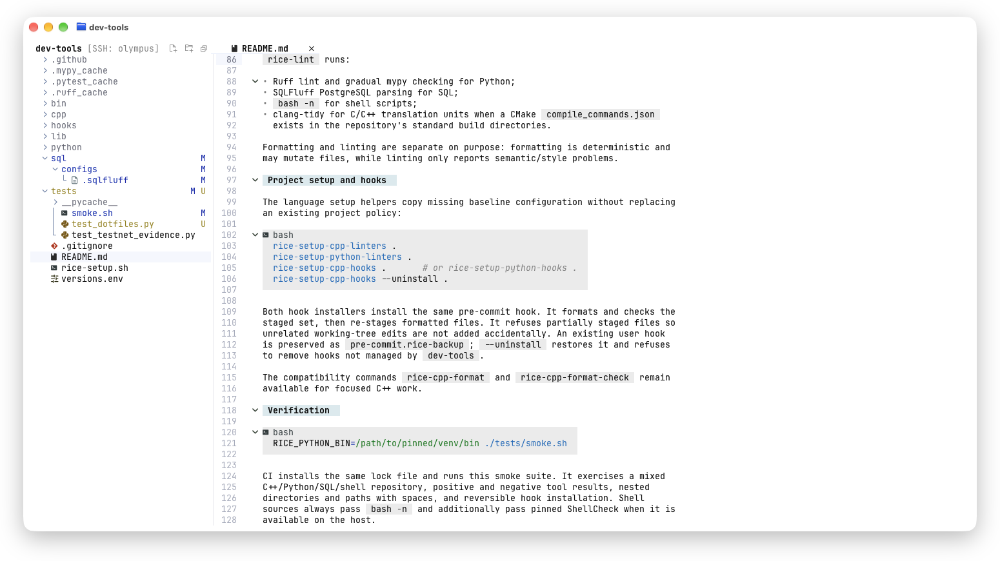
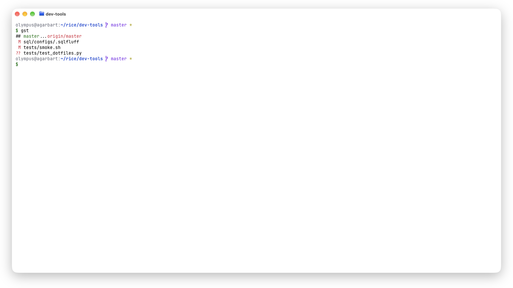

# Dotfiles

My terminal setup for macOS and Linux servers.

Most of my work happens on remote machines over SSH. I wanted the same shell
and editor there as on my laptop, with the conveniences of a desktop IDE, and
a new server set up with a single command. This repository does that. If you
work the same way, use it as is or take the parts you need.

## What's inside

- **Ghostty**: the terminal on macOS.
- **zsh + Starship**: the shell and a prompt that shows the git branch.
- **Neovim** with a set of plugins that make it work like a desktop editor:
  a file tree, tabs, the mouse, Cmd shortcuts, search, and code navigation
  for C++ and Python.
- **Git aliases**: short commands for everyday git. `ghelp` lists them.

Everything uses JetBrains colors and follows the light or dark theme of macOS.

<picture>
  <source media="(prefers-color-scheme: dark)" srcset="docs/screenshots/editor-dark.png">
  
</picture>
<picture>
  <source media="(prefers-color-scheme: dark)" srcset="docs/screenshots/shell-dark.png">
  
</picture>

The screenshots follow your GitHub theme. Switch it to see the other variant.

## Install

```bash
curl -fsSL https://raw.githubusercontent.com/garbart/dotfiles/main/install.sh | bash
```
