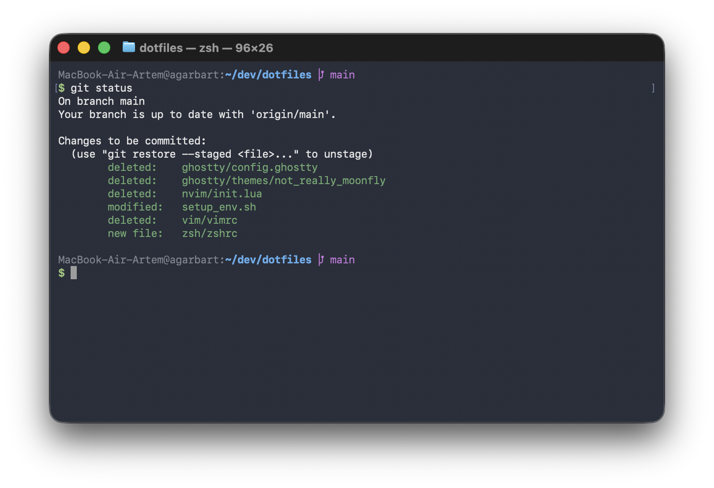

# Dotfiles

Tiny zsh + Starship setup for macOS, Ubuntu, CentOS, and Rocky Linux.



## Install

```bash
git clone git@github.com:garbart/dotfiles.git
cd dotfiles
./setup_env.sh
exec zsh
```

Run as a regular user. The script uses `sudo` when needed and installs Homebrew
on macOS if it is missing.
